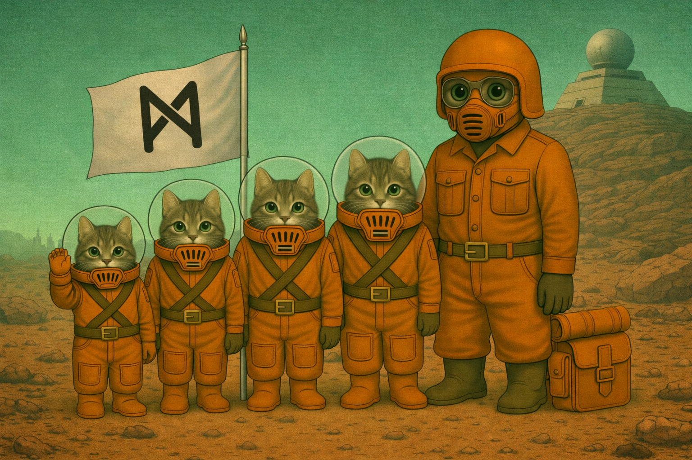
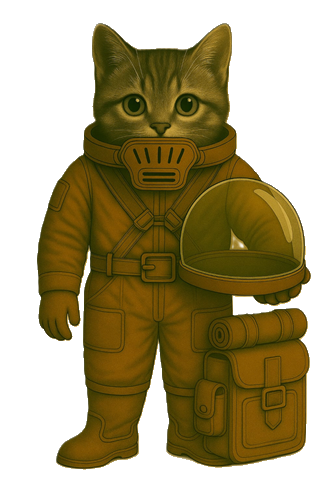
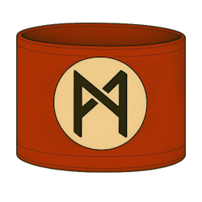
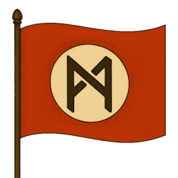
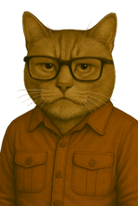
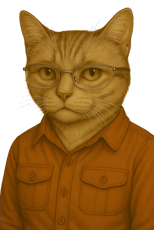

# Staubpfoten

## 🎭 Das Rollenspiel

Hab Spaß auf dem Mars! Erlebe Gefahren und Abenteuer – und finde heraus, wie weit du gehen wirst, um den Mars und das Marservolk zu retten.

**Das Rollenspiel in Kürze:**

1. Du bist eine Katze auf zwei Beinen – eine Felin.
2. Du lebst auf dem Mars. Seine Atmosphäre ist giftig, deshalb brauchst du einen Schutzanzug.
3. Der Marsianische Zephir herrscht über den Mars. Er ist wahnsinnig und hat einen Krieg angezettelt.
4. Du bist zwangsweise Mitglied der MZ-Kadettschaft. Dort sollst du zu einem ordentlichen, wehrfähigen Soldaten erzogen werden.
5. Irgendwann merkst du, dass das alles kein Spiel ist. Was wirst du tun?

{ style="float:right; width:50%;" }

Jeder Charakter hat eine eigene **Behinderung oder Einschränkung** – körperlich, sensorisch oder psychisch. Sie ist mehr als ein Merkmal: Sie beeinflusst die Spielweise, Entscheidungen und möglichen Lösungen.

**Atmosphäre: Mars, Krieg und Raumschiff**

  <audio controls preload="auto">
    <source src="assets/audio/nand-echo.ogg" type="audio/ogg">
    Dein Browser unterstützt das Audio-Element nicht.
  </audio>

## 🔴 Mars, 2045

Die unendliche Weite des Horizonts, überspannt von einem sanft grünen Himmel. Sand in vielen Farbtönen: Ocker, Ziegelrot, dunkles Braun. Hier bist du geboren – auf dem Mars.

Es riecht nach Brom. Dein Filter ist alt und hätte längst ersetzt werden müssen. Das Brom schmeckt bitter und ist ätzend.

> Ihr schlüpft in die Rollen **Marser Kinder**.
> Marser sind katzenartige Wesen mit Fell, schwarzen Nasen und Schnurrhaaren.
> Erlebt ein Abenteuer – und macht die Welt ein bisschen besser!

{ style="float:right; width:50%;" }

Die Handlung spielt auf dem Mars einer nahen Dimension. Du bist eine Felin: eine Katze auf zwei Beinen, die in einem Schutzanzug lebt.

Der Mars steht kurz vor dem Krieg – oder der Krieg hat bereits begonnen. Du bist Mitglied der **MZ-Kadettschaft**, einer paramilitärischen Organisation, die junge Menschen zu Soldaten ausbildet.

Das bedeutet nachmittägliche Gruppenstunden, mehrtägige Wehrertüchtigungslager und einen HR-Führerschein. Bald bekommt ihr sogar richtige Aufträge: zum Beispiel, eine KI zu überwachen oder sie selbst zu „plasmieren“.

**Nieder mit den KI!**

(Oder auch nicht.)

## Disclaimer

### 🛸️ Zum Spielsystem und seiner historischen Einordnung

{ style="float:left;width:50%;margin-right:25px" }

Dieses Spielsystem soll zur kritischen Auseinandersetzung mit diktatorischen Strukturen anregen. Kontrolle, Propaganda, Gehorsam, Gruppenzwang und Gewalt werden nicht ästhetisiert oder romantisiert, sondern sichtbar gemacht und hinterfragt.

Das Spiel verherrlicht weder die Verbrechen des Nationalsozialismus noch dessen Ideologie. Es verfolgt einen aufklärerischen Ansatz und soll insbesondere junge Menschen für die Gefahren totalitärer Systeme, Faschismus, Diskriminierung und ideologischer Verblendung sensibilisieren.

Wir verstehen das Spiel als Beitrag zur historischen und politischen Bildung. Seine Themen werden durch Spielmechaniken, moralische Dilemmata und narrative Konflikte erfahrbar – ohne Leid oder Gewalt zu trivialisieren.

### ⚠️ Triggerwarnungen

Das Spiel behandelt unter anderem:

- Ideologie und Propaganda
- Gruppenzwang, Mitläufertum und Verrat
- Irrtum, Zweifel und Ungewissheit
- Tod und Gewalt
- Körperhorror und körperliche Veränderungen
- Ungerechtigkeit und Diskriminierung von Minderheiten

### 🜁 Hintergrund

Grundstimmung und Themen des Spiels beruhen unter anderem auf den Kriegserlebnissen von Ferdinand Riegel, dem Vater der Autorin des Buches *Ich bin Nand* und dieses Rollenspiels. Seine Erfahrungen aus dem Zweiten Weltkrieg prägen die emotionale Tiefe des Spiels.

Im Spiel gibt es die Möglichkeit, Menschen und andere Wesen zu retten und kleine Veränderungen zum Guten anzustoßen. Denn hier wie im richtigen Leben gilt: die Welt ein bisschen besser machen – und Entscheidungen treffen, die damals hätten getroffen werden sollen.

## 🎓 Inspirationsquellen

Das Spiel steht in der Tradition von Werken, die sich mit Macht, Militarismus und autoritären Gesellschaften auseinandersetzen:

- **„Starship Troopers“** von *Robert A. Heinlein*
- **„1984“** von *George Orwell*
- **„Fahrenheit 451“** von *Ray Bradbury*
- **„V – Die außerirdischen Besucher kommen“**
- **„Herr der Fliegen“** von *William Golding*

Diese Werke und das Rollenspiel eröffnen unterschiedliche Perspektiven auf Militarismus, Sprach- und Informationskontrolle, Angst, Widerstand und den Zerfall gesellschaftlicher Ordnung.

## 🌍 Diversität und Inklusion

Das Spiel wurde mehrfach beim monatlichen Rollenspieltreff des Rollenspielvereins Freiburg angeboten. Die Rückmeldungen waren durchweg positiv.

Jede Figur hat eine Behinderung oder Einschränkung – körperlich, sensorisch oder psychisch. Die Spielenden entscheiden selbst, welche Einschränkung ihr Charakter hat und wie sie dessen Leben beeinflusst.

Das ermöglicht unterschiedliche Perspektiven auf Barrieren und Teilhabe. Spielende können sich mit Erfahrungen auseinandersetzen, die ihnen fremd sind, oder neue Aspekte von Behinderung erkunden. Ziel ist es, Empathie und ein besseres Verständnis für Inklusion zu fördern.

**Hinweis:** In der Spielwelt werden Charaktere mit Einschränkungen durch die Ideologie der Kadettschaft abgewertet und angefeindet. Das ist als Kritik an Ausgrenzung und eugenischem Denken gemeint, kann aber belastende Situationen am Spieltisch auslösen.

## 🎲 Erfahrungen am Spieltisch

In den Spielrunden kamen unter anderem folgende Themen und Situationen auf:

- Gespräche über das „Dritte Reich“, Propaganda und die Auseinandersetzung damit im Schulunterricht
- Freude darüber, die Einschränkung der eigenen Figur selbst wählen zu können
- Ein Dilemma, in dem eine KI aus Eigennutz vernichtet wurde – und eine Mitspielerin daraufhin eine „Weiße Rose“ zur Rettung der KI gründen wollte

## 🛡️ Nie wieder!

„Nie wieder“ ist kein leeres Wort, sondern eine Haltung, die gelernt, verstanden und gelebt werden muss. Dieses Spiel möchte dazu beitragen, indem es zeigt, wie diktatorische Systeme entstehen, funktionieren und wohin sie führen können.

## Impressum

**Verantwortlich für den Inhalt dieser Website:**
Dr. Mareike Riegel
[info@staubpfoten.de](mailto:info@staubpfoten.de)

### Datenschutz

Diese Website ist vollständig statisch und speichert nach Angaben der Betreiberin keine Informationen.

### Bilder

Michael Dietrich &amp; AI (KI-generierte Bilder)

Mareike Riegel (Handzeichnungen mit Bleistift, Tinte und Kohle)
