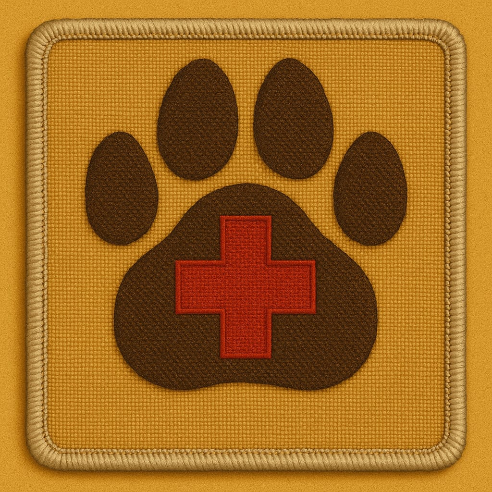
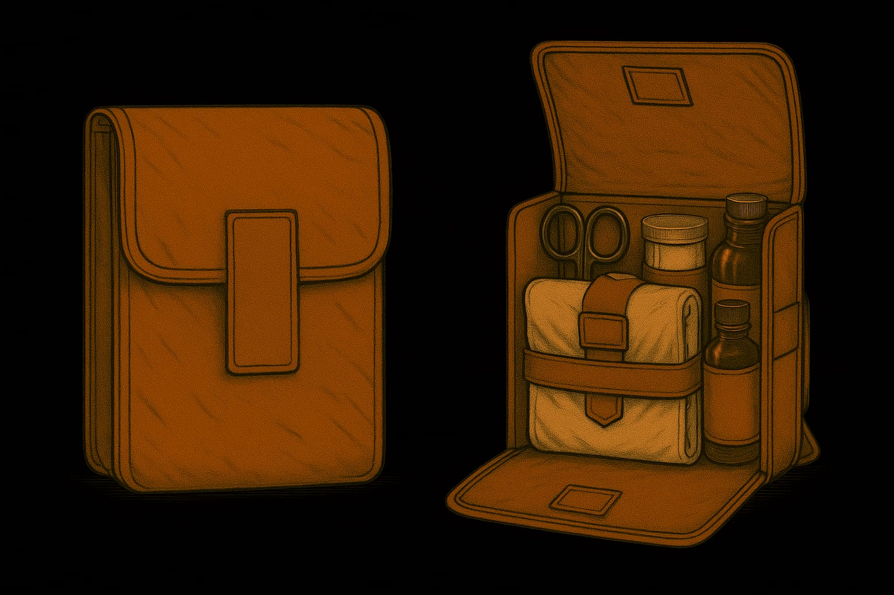

# Medizin

## Sanitäter-Abzeichen

## Medikit

## Krankheiten

### Pratzenlähmung (Polio)

Der Erkrankte wird schwach, die Nerven geschädigt.
Bei schwerem Krankheits-Verlauf kann er nicht mehr atmen und stirbt.

* Vorbeugung: Schutzi (Impfung), ist noch in der Erprobungsphase
* Behandlung: Ruhe
* Spätfolgen
    * Pratzenlähmung, Gehbehinderung
    * selten: kein eigenständiges Atmen => Eiserne Lunge lebenslang, Terranische Froschatmung kann erlernt werden

## Barbische Bio-Technologie

Die fortgeschrittene barbische Bio-Technologie kommt nach dem 2. Interplanetarischen Krieg auf den Mars, teils.
Dazu gehören z. B. die Farnholz-Beine für amputierte Gliedmassen und die Entkörperung.

### Bromismus

# Bromismus

Der echte Bromismus (Bromvergiftung) führt unter anderem zu Müdigkeit, Verlangsamung, Gedächtnisproblemen, Verwirrung, Halluzinationen und Persönlichkeitsveränderungen. Für das Rollenspiel ist diese Darstellung etwas dramatisiert, lehnt sich aber erkennbar an die echten Symptome an.

* **Stufe 1 – Bromkontakt**
   * **Symptome:** Trockener Hals, leichter Husten, müde Augen, Konzentrationsprobleme.
   * **Auswirkung:** Gelegentliche Ablenkung, leichte Mali auf Wahrnehmung.
* **Stufe 2 – Früher Bromismus**
    * **Symptome:** Müdigkeit, verlangsamte Reaktionen, Wortfindungsstörungen, Kopfschmerzen.
    * **Auswirkung:** Langsamere Reaktionen, vergisst Kleinigkeiten.
* **Stufe 3 – Marsmüdigkeit**
    * **Symptome:** Starke Erschöpfung, Gleichgewichtsstörungen, emotionale Teilnahmslosigkeit, häufiges Gähnen.
    * **Auswirkung:** Körperliche Tätigkeiten erschwert, Motivation sinkt.
* ****Stufe 4 – Bromfieber**
    * **Symptome:** Reizbarkeit, Stimmungsschwankungen, Misstrauen, leichte Halluzinationen.
    * **Auswirkung:** Fehleinschätzungen häufen sich, soziale Interaktionen erschwert.
* **Stufe 5 – Bromträume**
    * **Symptome:** Tagträume, vermischte Erinnerungen, Stimmen hören, die Realität wirkt unwirklich.
    * **Auswirkung:** Visionen, falsche Erinnerungen, Schwierigkeiten, Realität und Einbildung zu trennen.
* **Stufe 6 – Schwerer Bromismus**
    * **Symptome:** Orientierungslosigkeit, starke Halluzinationen, Verfolgungsgefühle, Erinnerungslücken.
    * **Auswirkung:** Zeitweiser Kontrollverlust, Verwechslung von Personen und Situationen.
* **Stufe 7 – Bromschlaf**
    * **Symptome:** Völlige Apathie, kaum Antrieb, ständiges Schlafbedürfnis, verzögerte Reaktionen.
    * **Auswirkung:** Nahezu handlungsunfähig, benötigt Hilfe von anderen.
* **Stufe 8 – Bromflüsterer**
    * **Symptome:** Hört Stimmen im Wind, sieht Muster und Zeichen, spricht mit Unsichtbarem, wirkt entrückt.
    * **Auswirkung:** Erhält möglicherweise Visionen oder folgt gefährlichen Einbildungen. Die Spielleitung kann Hinweise oder Irrwege geben.
