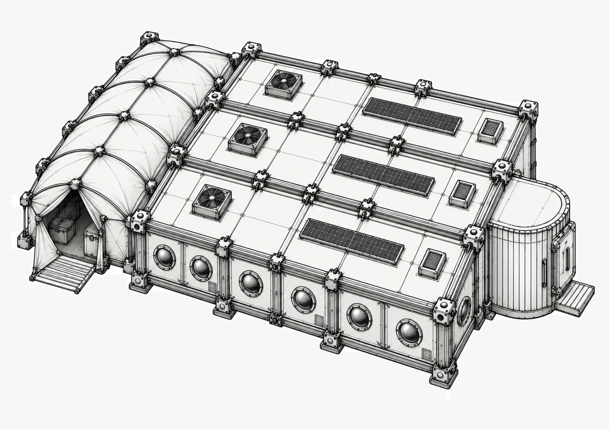

# Wehrertüchtigungslager (WEL)

::: carousel

:::

Das **Wehrertüchtigungslager**, kurz **WEL**, ist ein militärisches Ausbildungs- und Übungslager bei **Bromsal**. Hier werden junge Kadetten ausgebildet und auf ihre späteren Aufgaben vorbereitet.

Das Lager ist zweckmäßig und einfach gehalten. Vieles wirkt eher zusammengebaut als geplant. Zwischen Containern, Zelten und Arbeitsbereichen liegt der große Exerzierplatz.

## Der Exerzierplatz

Der **Exerzierplatz** bildet das Zentrum des WEL. Hier finden die täglichen Übungen statt.

Es ist ein staubiger, ockerfarbener Platz mit aufgesprungenem Boden. Weiße Kreidelinien markieren Marschwege. Rote Fähnchen flattern an krummen Metallpfählen. In der Ferne glühen rostige Lautsprecher im grellen Sonnenlicht.

Auf dem festgestampften Marsboden wird:

- marschiert und angetreten,
- körperlich trainiert,
- mit Ausrüstung geübt,
- der Umgang mit den HR trainiert,
- und gelegentlich für größere Übungen angetreten.

Der Boden ist von unzähligen Fußspuren zerfurcht. Die schweren Hebroboter hinterlassen zusätzlich tiefe Abdrücke.

* **Container**: großer, zweckmäßiger Container am Rand des Exerzierplatzes Mischung aus Baracke und übergroßer Metallkiste.
* **Exerzierplatz**: große, ebene Fläche aus festgestampftem Marsboden. Von unzähligen Stiefelspuren und R-Lauffen zerfurcht.
* **HR-Port**: überdachter Arbeitsstand aus dicken Balken mit einem einfachen Dach
* **Schrott**: Schrottansammlung aus Röhren, Lauffen, Kränen …
* **Donnerbalken**: ein über eine Grube gelegert Balken, riecht nach Kacka.

## Der Kadettencontainer

Am Rand des Exerzierplatzes steht der **Kadettencontainer**. Er dient als Unterkunft und Aufenthaltsbereich der Kadetten.

Im Container befinden sich:

- **Kuppelschleuse** – Übergang zwischen Außenwelt und Container.
- **Vestibül** – kleiner Eingangsbereich mit Bänken und Anschlagbrett.
- **Flur** – verbindet die einzelnen Räume.
- **Gruppenräume** – zum Lernen, Essen, Spielen und Besprechen.
- **Spinde** – persönliche Aufbewahrung der Kadetten.

Der Container ist praktisch eingerichtet, aber deutlich auf viele junge Bewohner ausgelegt. Ordnung hält meistens nicht besonders lange.

## Die Geraffelei

Neben dem Container steht das **Geraffelei-Zelt**. Hier wird die Ausrüstung der Kadetten aufbewahrt.

Zwischen Seilen, Decken, Werkzeugen und Tarnzeug findet sich allerlei weiteres Gerümpel. Was genau gebraucht wird, wissen meistens die Kadetten selbst.

## Wachhäuschen

Ein kleiner, würfelförmiger Posten aus sandfarbenem Komposit. Innen blinkt ein grünes Display. Außen hängt eine zerschlissene Flagge. Ein übergroßer Helm liegt auf der Fensterbank – wohl vergessen.

## Stabsgebäude

Im **Stabscontainer** sitzen die Offiziere und Ausbilder. Hier werden Nachrichten bearbeitet, Übungen geplant und organisatorische Dinge geregelt.

Es ist ein reinweißer Blockbau mit spiegelnden Fenstern und blauen Leuchtstreifen. Zwei echte Soldaten stehen davor – grün-grau uniformiert, mit goldenen Rangabzeichen. Das Gebäude strahlt Ordnung, aber auch Angst aus.

Kadetten kommen hierher, wenn sie:

- Anweisungen erhalten,
- sich melden müssen,
- für besondere Aufgaben eingeteilt werden,
- oder Ärger bekommen haben.

## Der HR-Port

Der **HR-Port** ist der Arbeitsbereich für die landwirtschaftlichen **Hebrobotos (HR)**.

Er besteht aus einem einfachen Gerüst aus dicken Balken mit einem Dach darüber. Unter dem Dach befinden sich:

- funktionierende HR,
- Reparaturgestelle,
- Akkuladestationen,
- Werkzeug,
- Ersatzteile
- und verschiedene Arbeitsgeräte.

Die großen Landwirtschafts-HR sind etwa **2,3 Meter hoch** und rund **450 kg schwer**. Sie sind deutlich massiger als die kleineren und beweglicheren Kampf-HR.

* **HR-Port**: Einfacher, überdachter Arbeitsstand aus dicken Balken und einem flachen Dach, überall Spuren von Erde, Staub und Öl.
* **Roter HR**: wuchtiger Hebroboto, kräftige Beine, Greifarme und zahlreiche Anschlüsse für landwirtschaftliche Geräte
* **Blauer HR**: hängend an Balken, halb geöffnet in Reparaturgestell, daneben Panzerplatten, Kabel quellen aus dem Rumpf, amputiertes Bein.
* **Akkuladestation**: Mehrere dicke Ladekabel hängen von einem Balken herab. Hier werden die schweren Akkus der Hebrobotos geladen oder ausgetauscht.
* **Schrottschütte**: große, offene Mulde voller kaputter Werkzeuge, alte HR-Greifer, Kabel, Schläuche.

## Schrott und Reparatur

Direkt am HR-Port liegt die **Schrottschütte**. Hier landet alles, was nicht mehr gebraucht wird – oder zumindest offiziell nicht mehr gebraucht wird.

Zu finden sind unter anderem:

- kaputte Werkzeuge,
- verbogene HR-Greifer,
- Kabel und Schläuche,
- alte Akkus,
- Sensoren,
- Zahnräder,
- Metallplatten
- und allerlei Maschinenteile.

Für die Kadetten ist der Schrotthaufen eine erstaunlich gute Quelle für Ersatzteile und Dinge, die man eigentlich gar nicht haben sollte.

## Die verbotene Lagerhalle

Am Rand des Geländes steht eine alte **Lagerhalle**. Ihr Eingang ist mit einem großen **„Verboten“-Kreuz** gesichert, das aus zwei alten Schaufeln zusammengenagelt wurde.

Was sich darin befindet, ist nicht allgemein bekannt.

Gerade deshalb übt die Halle auf die Kadetten eine gewisse Anziehungskraft aus.

## Donnerbalken

* **Grube mit Donnerbalken**: lange, offene Grube mit mehreren einfachen Sitzbrettern darüber, niedrige Holzwand bietet etwas Sichtschutz, daneben Eimer mit Erde und Kalk
* **Lagerhalle**: alte, verriegelte Lagerhalle aus Verbotene Wellblech und Stahlträgern. Vor dem Eingang steht ein großes „Verboten“-Kreuz, hastig aus zwei alten  Schaufeln zusammengenagelt.
* **Schrotthaufen**: wilder Haufen aus Metall, Kabeln, Werkzeugen und ausrangierten Maschinenteilen. Zwischen rostigen Teilen und staubigen Kisten findet sich erstaunlich viel, das noch irgendwie funktionieren könnte.

Links, im Südosten des Exerzierplatzes erhebt sich eine hohe Mauer aus zusammengeschweißtem Schrott. Dahinter verbirgt sich die Abtrittsgrube mit einem langen Donnerbalken aus verwitterten Bohlen – schon aus einiger Entfernung weht euch ein kräftiger, säuerlicher Geruch entgegen, der keinen Zweifel daran lässt, welchem Zweck  dieser Ort dient.

Noch weiter links, am Rande des Donnerplatzes erhebt sich das grosse, dunkle Lagerhaus. Mehrere gelbe Warnschilder klären darüber auf: „Gefährlich“ und „Betreten verboten“.

Es riecht ganz schön streng dort. Es gibt einen klaren Pfad hin zum Donnerbalken, der von vielen Stiefeln geformt wurde.

Über der Grube  befinden zwei eiserne H-Träger, auf denen man zur Mitte balcancieren muss. Dort befinde sich eine kleine Platform. Auf der Platform befindet sich ein weiterer Umschlag, der mit einem Brocken Brom beschwert wurde, damit er nicht wegfliegt

Findbare Dinge im Schrotthaufen (Beispiele)

* Verbogener HR-Greifer
* Kaputtes Funkgerät
* Noch funktionierende
Taschenlampe
* Alter Akkupack
* Halber Werkzeugkasten
* Einzelnes Zahnrad von enormer Größe
* Funktionierender kleiner Elektromotor
* Kiste voller verschiedener Schrauben
* HR-Fuß mit nur drei Zehen
* Völlig unbekanntes Gerät mit einem einzigen Knopf

## Ornithopter-Landeplatz

Ein weitläufiges Landefeld. Die einzelnen Landeplätze sind durch gewaltige, auf den Boden gemalte Runenzeichen gekennzeichnet.

In der Ferne ragt ein schlichter Beobachtungsturm in den Himmel, während auf zwei der Landeplätze regungslos Ornithopter auf ihren nächsten Einsatz warten. Die fünf Container sehen irgendwie verloren aus.

Überall stehen Schilder herum wie „Achtung vor landenden Raumschiffen“ und „Schütze Dich vor der Düsenausstieb“ und „Hier geht’s zur Kombustions-Reinigung“.

## Brumsen-Stock

Auf einem leerstehenden Areal des Landeplatzes stehen grosse, kupplige, aus Farnbast gefertigte Brumsenstöcke. Der Brumsenstock hat vorne ein Einflug-Loh, hinten eine Klappe. Die muss man öffnen, um an den Hinog zu gelangen … und den nächsten Hinweis zu erhalten.

Eine Brumse ist aus Sicht der Kadetten ziemlich gross. Sie ist ein bisschen grösser als ein Helm, den ein Kadett trägt. Eine Brumse wiegt sicherlich 5-6 Stein. Sie wohnen in Schwärmen von ca. 100 Brumsen zusammen. Ihren Stock verteidigen sie vehement mit ihren Stacheln. Ihr Stich ist sehr schmerzhaft und verursacht 1 W6 Schaden.

