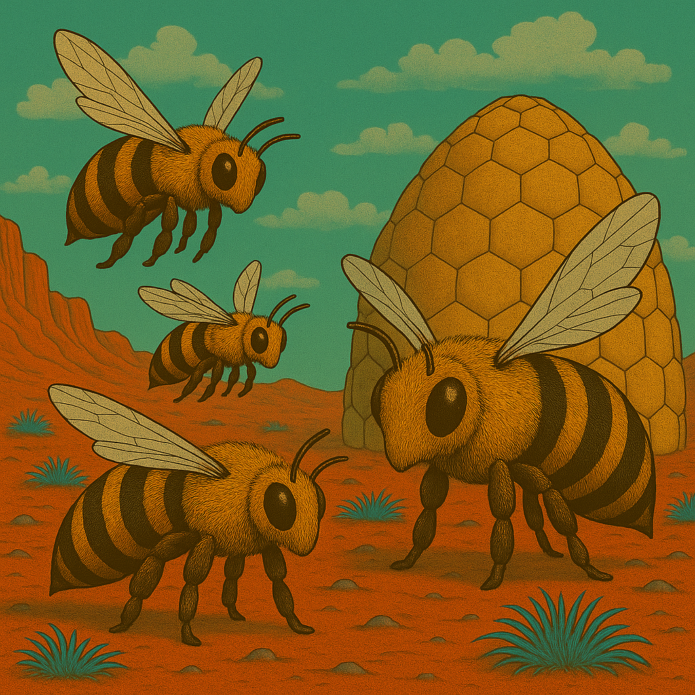
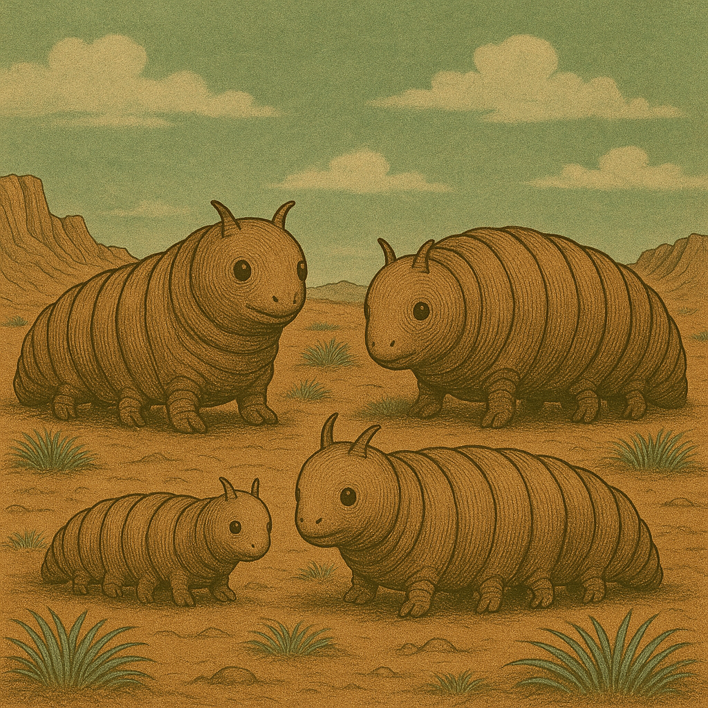

# Fauna

## Brumsen

Brumsen sind große, auffällige Insektenwesen. Ihr Körper ist von einem stabilen Panzer geschützt, während ihre Flügel ein deutlich hörbares Brummen erzeugen. Ihre Erscheinung wirkt auf Fremde einschüchternd.

**Lebensraum**: Brumsen leben in Nestern und werden von den Marsern teilweise gehalten. Ihre Nester bestehen aus geflochtenen Pflanzenfasern und anderen verfügbaren Materialien.

**Verhalten**: Brumsen reagieren aufmerksam auf ihre Umgebung. Wachbrumsen bewachen Eingänge und reagieren auf unbekannte Besucher.

Brumsen werden unter anderem als Wachtiere genutzt. Ihre Nester und ihr Verhalten sind ein vertrauter Teil des marsischen Alltags.

## Plötzen

Plötzen sind große, raupenartige Freundwesen mit durchscheinender Haut. Durch ihre Körperwand sind die inneren Organe sichtbar, die von den Marsern liebevoll Welse, Robengang, Bromscheide und Sekretwabbel genannt werden.

**Lebensraum**: Plötzen leben auf Höfen, Weiden und in eigens eingerichteten Ställen. Sie benötigen ausreichend Platz und Futter, beispielsweise Azurgras.

**Verhalten**: Plötzen sind freundlich, neugierig und nähern sich Besuchern häufig aus eigenem Antrieb. Ihre Bewegungen sind langsam, aber zielstrebig.

Plötzen gelten als Freundwesen und sind ein wichtiger Teil der Landwirtschaft. Sie werden gepflegt und gehalten und gehören zum vertrauten Bild vieler marsischer Höfe.

## Flittermolche

Flittermolche sind kleine Lebewesen, deren erwachsene Gestalt sich deutlich von ihren Larven unterscheidet. Ihre genaue Gestalt und Färbung ist nicht näher festgelegt.

**Fortpflanzung**: Flittermolche legen ihre Eier bevorzugt auf Leichen und Tierkadavern ab. Dort finden die später schlüpfenden Larven reichlich Nahrung.

**Verhalten**: Die Flittermolch-Maden gelten als ausgesprochen eklig. Sie sammeln sich auf dem Kadaver und ernähren sich von dessen Gewebe.

Flittermolche spielen eine Rolle beim Abbau toter Lebewesen. Ihr Auftreten kann auf einen Kadaver in der Nähe hinweisen und bei der Suche nach Vermissten eine unangenehme Entdeckung bedeuten.

## Echsenschupps

Echsenschupps sind echsenartige Lebewesen mit schuppiger Haut. Ihre genaue Größe, Färbung und Körperform ist nicht näher festgelegt.

**Lebensraum**: Sie leben vermutlich bevorzugt an warmen, geschützten Orten, etwa zwischen Steinen, in Höhlen oder in eigens eingerichteten Schuppställen.

**Verhalten**: Ihre Lebensweise und ihr Verhalten gegenüber Marsern sind noch nicht näher beschrieben.

Echsenschupps können Teil der marsischen Tierhaltung sein. Ob sie als Nutztiere, Haustiere oder wild lebende Tiere gelten, ist noch offen.

## Streitschupps

Streitschupps sind eine eigene Gruppe schuppiger Lebewesen.  Sie wurden von den Barben im Rahmen des Zweiten Interplanetaren Krieges nach Mars gebracht. Es sind kräftige Reittiere, die auf schwere Soldaten mit Panzerung tragen können.

**Verhalten**: Wie ihr Name vermuten lässt, könnten Streitschupps ein ausgeprägt streitbares oder territoriales Verhalten zeigen. Diese Eigenschaft ist bislang jedoch nicht näher festgelegt.

## Gallertkrabben

Gallertkrabben sind krabbenartige Lebewesen mit einem weichen, gallertartigen Körper. Es gibt sie in verschiedenen Grössen. Ihr Panzer ist bio-floreszent.

**Lebensraum**: Sie könnten in in feuchten, dunklen Arealen, bevorzugt in LT-Tunneln, oder auch an Wasserstellen oder in schlammigem Gelände.

## Flieder

Flieder sind lange, lamettaartige Wesen. Sie lassen sich mit dem Wind treiben und erzeugen dabei das typische Zwitschern.

## Heroldskäfer

Heroldskäfer sind grosse Käferwesen. Es sind sogenannte Schädlinge.

Jedes fünfte Jahr kehren die Käfer wieder und fressen Pilzfelder kahl. Landwirte HASSEN ihn! Auf hohe Dosen Brom reagieren sie empfindlich.

## Wasserfische

Wasserfische umfassen die im Wasser lebenden Fischarten des Mars. Sie können sich in Größe, Körperform, Färbung und Lebensweise unterscheiden.

Sie leben in den Gewässern des Mars.

Fische dienen u. a. zur Ernährung und zum ökologischen Gleichgewicht der marsischen Gewässer.
