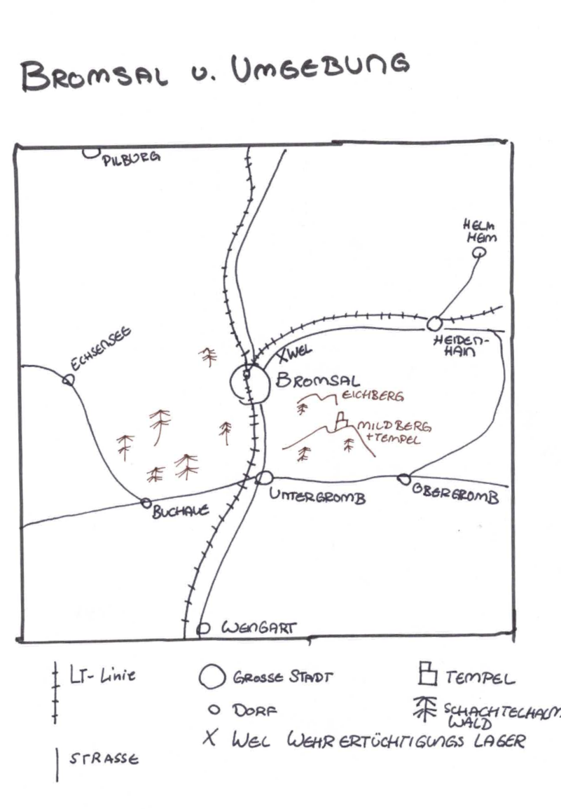
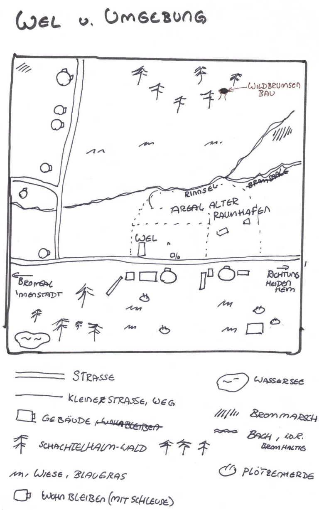
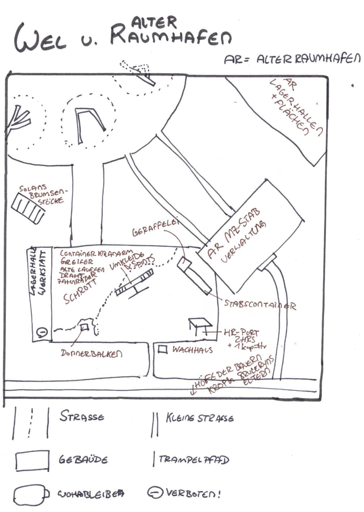
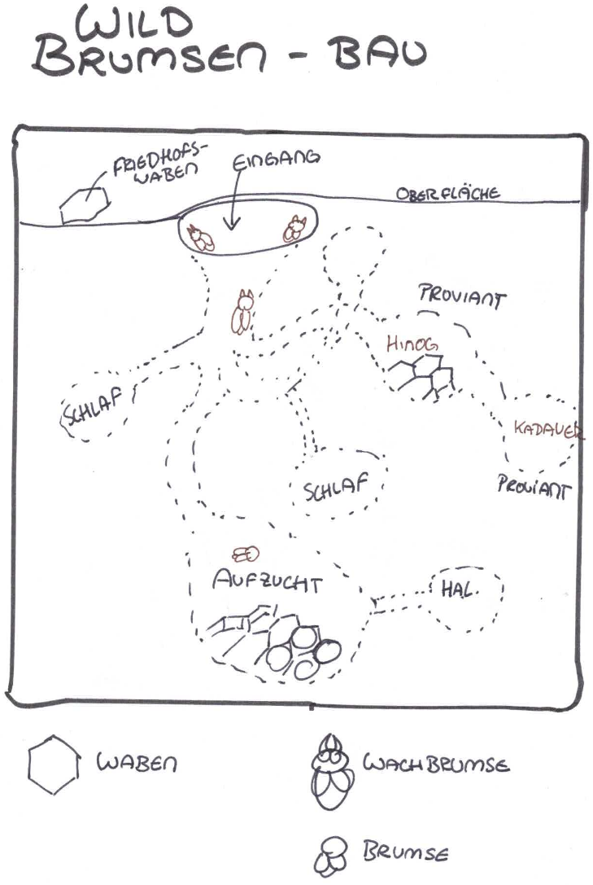
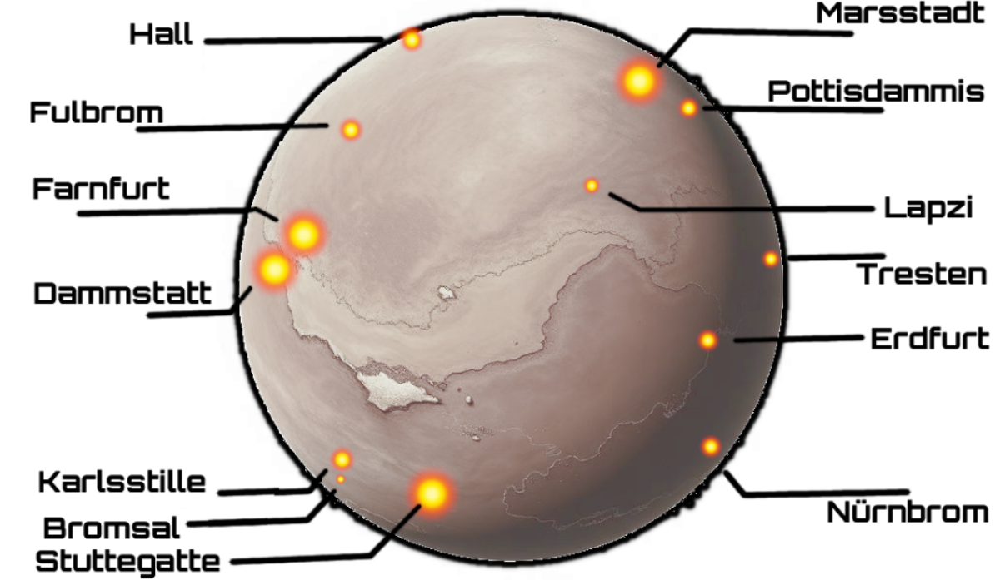

# Karten

## Bromsal und Umgebung

* **Bromsal**
    * mittelgrosse Stadt zwischen Freifahrt und Kruh
    * LastTransport-Gabelung
* **Eichberg** und "**Mildberg**
    * höhere Erhebung zwischen Bromsal und Untergromb
    * Mildberger Tempel auf Spitze des Mildbergs
* **XWel** - Wehrerziehungslager
* **Tunnel**
    * zwischen Bromsal und Haidenhain
    * dunkel
    * Flittermolche und Gallertkrabben
    * zwei Leuchtglobi an der Decke
    * der Weg ist holprig

**1. Bromsal**

– Politisches Zentrum auf dem Mars
– Nands Heimat
– Ziel eines Vakuumierungsangriffs (2045)
– Nähe zum LT-Gabelpunkt

**2. Mildberg & Eichberg**

– Heilige Hügel
– Mildberg trägt einen Tempel
– Spirituelle und kulturelle Bedeutung für Marser

**3. LT-Tunnel**

– Tunnelverbindung zwischen Bromsal und Haidenhain
– Dunkel, lebensfeindlich, stark bromverseucht
– Heimat von Raummolchen und Flittermolchen

**4.Wehrerziehungslager (WEL)**
– Ausbildungsstätte der MZ-Kadetten
– Befindet sich auf Gelände eines alten Raumhafens
– Ausstattung:
    * Exerzierplatz
    * Modularfaust mit Nachtigallerator (HR-Port)
    * Brumsenstöcke
    * Lagerhalle, Proviantzelt, Wachhäuschen, Verwaltungsgebäude
    * Raumhafen-Landeplatz
    * Umgeben von Höfen (z. B. Hof von Krop Orbs Eltern)
    * Plötzenweide im Süden

**5. Friedberg (XVIII)**

– Ort zur Aufbahrung Verstorbener
– Beispiel: Tante Mary nach Angriff auf Bromsal

## Wehrerziehungslager und Umgebung

* **Wehrerzieungslager**: grosses Gelände auf Teilen des ehemaligen Raumhafens
* **Bauernhöfe** (in südlicher Richtung)
    * Hof von Krop Orbs Eltern: Ein aus Blechteilen zusammengeschweisster Bauernhof mit rötlicher Schutzlackierung. Im Hof wachsen Marswurzeln aus künstlich bewässerten Rillen. Über allem liegt ein bronzefarbener Solarschirm. Ein Generator surrt freundlich.
    * Hof von Brul Eryns Eltern: Hellgelber Anbau an einem alten Frachtcontainer. In den Fenstern hängen blaue Tücher. Zwei klapprige Drohnen kreisen über kleinen Tiergehegen aus Netzstoff. Die Erde hier ist heller, fast sandweiss – ungewöhnlich für die Gegend.
* **Plötzenweide** (in südlicher Richtung): Ein flacher Krater mit grün-grauen Futterstreifen. Die Plötzen sind plump und kuhartig, mit schimmernden Häuten in Violett, Beige oder Hellblau. Ihr Sekret tropft in tiefe Auffangschalen aus gebürstetem Stahl. In der Ferne stehen Windtürme, die surren wie Insekten.

🛡️ Wehrerziehungslager (WEL)

– Gelegen auf altem Raumhafen-Areal
– Ausbildungsort der MZ-Kadetten
– Umgebung landwirtschaftlich geprägt

Enthaltene Einrichtungen:

- Exerzierplatz
- Stabscontainer
- Proviantzelt
- Modularfaust mit Nachtigallerator
- Brumsenstöcke
- Lagerhalle
- Verwaltungsgebäude
- Plötzenweide
- Schrottfeld
- Landeplatz

Umliegende Bauernhöfe:

- z. B. Hof von Brul Eryn oder Krop Orbs Eltern

## Wehrerziehungslager und Alter Raumhafen

* **Exerzierplatz**: Ein staubiger, ockerfarbener Platz mit aufgesprungenem Boden. Weisse Kreidelinien markieren Marschwege. Rote Fähnchen flattern an krummen Metallpfählen. In der Ferne glühen rostige Lautsprecher im grellen Sonnenlicht.
* **Modularfaust mit Nachtigallerator (HR-Port)**: Graublauer Kuppelbau mit leuchtenden Sensorstreifen in Orange. Der Nachtigallerator brummt leise – wie ein schnarchender Vogel. Zwei Hebrobotos stehen am Port:
    * Klein & Neu: mattweiss mit blauen Lichtaugen.
    * Gross & Alt: rostrot, wuchtig, mit abgeplatztem Lack und einem langsam mahlenden Arm.
* **Stabscontainer & Schrottfeld**: Der Stabscontainer ist ockerrot, mit einer grellgelben Tür und Funkantenne. Daneben: das Schrottfeld. Alte Raumschiffteile liegen unter der roten Marskruste wie Knochen. Vieles glitzert silbern oder ist mit lila Rost überzogen – Relikte vom alten Raumhafen.
* **Wachhäuschen**: Ein kleiner, würfelförmiger Posten aus sandfarbenem Komposit. Innen blinkt ein grünes Display. Aussen hängt eine zerschlissene Flagge. Ein übergrosser Helm liegt auf der Fensterbank – wohl vergessen.
* **Landeplatz des alten Raumhafens**: Graubraune Betonplatten mit ausgebleichten Futhark-Zeichen, die unter dem Staub hervorblitzen. Zwischen den Rissen summen die Brumsenstöcke – dunkelviolett-glänzende Bienenröhren mit wächsernen Ringen, aus denen warmer Duft aufsteigt.
* **Verwaltungsgebäude**: Reinweisser Blockbau mit spiegelnden Fenstern und blauen Leuchtstreifen. Zwei echte Soldaten stehen davor – grün-grau uniformiert, mit goldenen Rangabzeichen. Das Gebäude strahlt Ordnung, aber auch Angst aus.
* **Lagerhalle des alten Raumhafens**: Breite Halle mit rostigen Wänden, die im Sonnenlicht orange schimmern. Drinnen stehen nur noch drei Container:
    * Einer enthält vergilbte Marskarten und zerknickte Raumanzüge
    * Einer ist mit Werkzeugresten und Stuhlteilen gefüllt
    * Der dritte ist verschlossen, mit einem alten Symbol in Silber und Schwarz

## Brumsenbau im Schachtelhalmwald

## Mars

**Großes Bromdelta**

– Seit dem letzten Bromsturz extrem bromhaltig
– Als unheimlich und gefährlich bekannt

**Marsstadt**

– Hauptstand des Mars
– Sitz der Regierung

## Sonnensystem

**Neith (Venusmond)**

– Ort des Neith-Unfalls (1990), wo sich der Raum-Zeit-Riss öffnete
– Wurde später von einer barbischen Vorhut besiedelt
– Ort des Dimensionsrisses (1990)
– Erste Landung der Barben (1993)

**Pluto**

– 2045 durch UW-Bombe zerstört
– Ursprung einer neuen Spalte zur Gottesdimension
– Verseuchung durch Unwahrscheinlichkeit
– Ziel der UW-Bombe
– Zerstört, Ursprung weiterer Risse & Gottesinterventionen

**Ganymed**

– Letzter Nagel am Sarg des Angrifes auf den Jupiter und dessen Marse
- zu kalt, die Kälte vernichtet die Marser Armee
– Evakuierungsschiff flieht von dort

**Proxima Centauri**

– Von den Barben als Ursprung ihres Volkes verehrt
– Ursprungsmythos für orange-katholische Ideologie
– Ursprung der Barben (theologisch betrachtet)
– Keine direkte Anreise mehr dokumentiert
